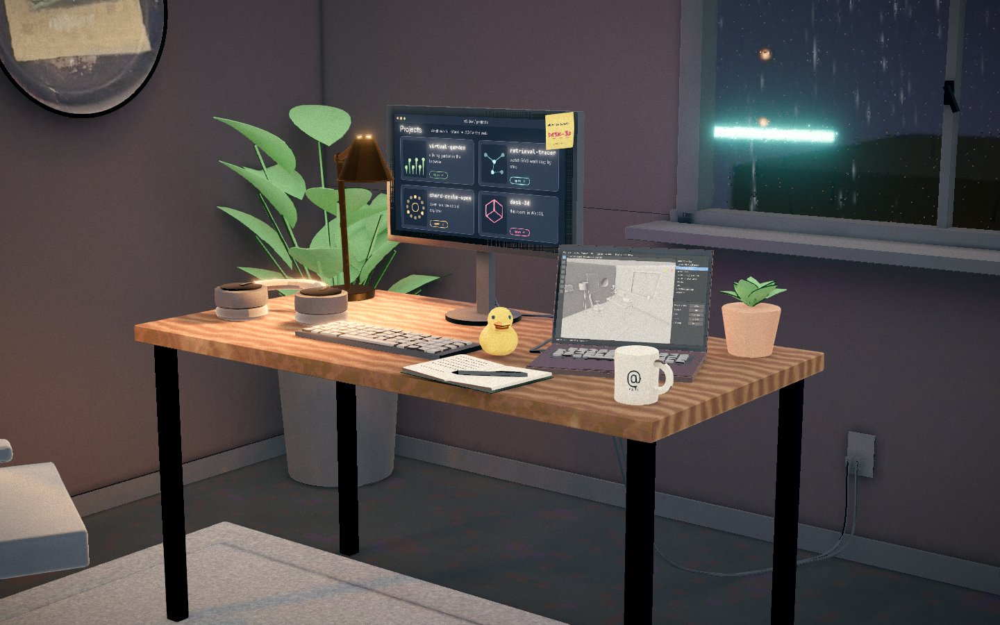

**roiyot26.github.io** is my portfolio: a 3D room where each object opens a panel about my work as a full-stack developer, with a one-page plain version for slow devices. It is a personal project, live at https://roiyot26.github.io/.

**Stack:** React 18, TypeScript, react-three-fiber, drei, postprocessing, Vite and Vitest. The room is modelled and baked in Blender and shipped as glTF with Draco geometry and KTX2 textures. GitHub Actions deploys it to Pages.

**Hard problems solved:** six baked lightmap groups blended live in one render target, so the switches dim real baked light with no scene lights; room labels whose 44 px tap areas never overlap each other or the UI, on any screen size; one scene that runs on desktops, phones and software GL, with quality tiers, a runtime step-down and a plain HTML fallback.

**Perf, measured 2026-10-19:** Vite build output: entry JS 85 kB gzip, lazy 3D chunk 609 kB gzip, CSS 7.4 kB gzip. GLB 6.0 MB on disk, 5.1 MB transferred. Full room payload 9.3 MB transferred (Chrome DevTools Protocol, cache off). On a CPU-only box with software GL: first contentful paint 0.38 s and room ready in 6.6 s at 1440×900, Lighthouse 12 performance 64 desktop and 42 mobile. More in [docs/spec.md](docs/spec.md).
